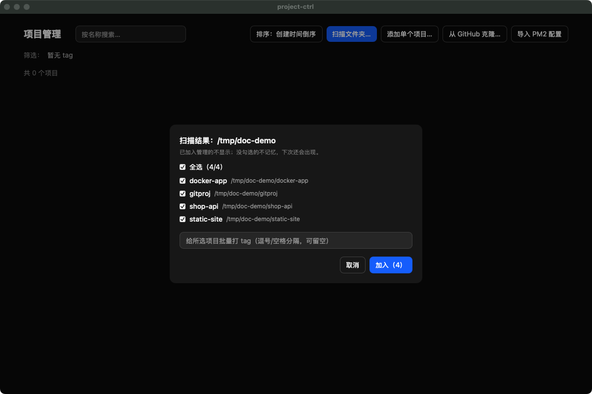
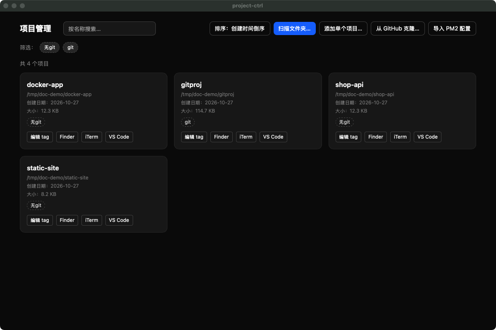
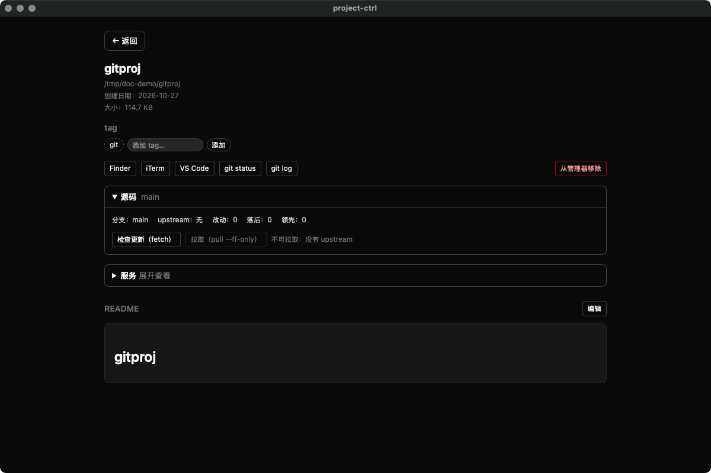
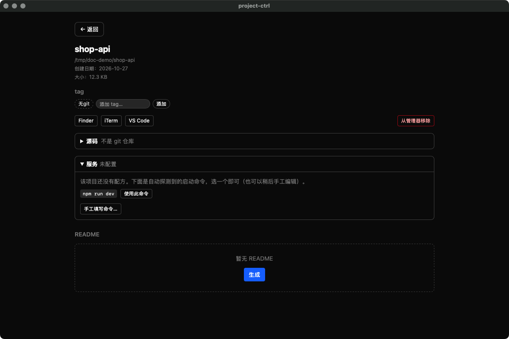
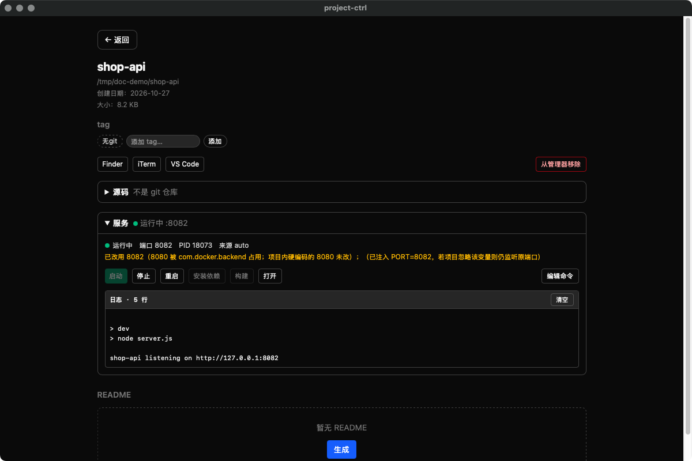

# project-ctrl 使用说明

一台 Mac 上的项目管家：把散落在各处的仓库收进来、打 tag 归类、看 README，
以及 —— 从 v0.2.0 起 —— **更新源码、构建、启动服务、避开端口冲突**。

> 截图来自 `docs/images/`，都是真实的界面（不是示意图）。

---

## 目录

1. [第一个项目：把目录收进来](#1-第一个项目把目录收进来)
2. [列表页：找得到、分得清](#2-列表页找得到分得清)
3. [详情页：一个项目的全部操作](#3-详情页一个项目的全部操作)
4. [让项目跑起来：服务面板](#4-让项目跑起来服务面板)
5. [端口冲突是怎么解决的](#5-端口冲突是怎么解决的)
6. [更新源码：源码面板](#6-更新源码源码面板)
7. [从 GitHub 克隆](#7-从-github-克隆)
8. [导入已有的 PM2 配置](#8-导入已有的-pm2-配置)
9. [数据、边界与已知限制](#9-数据边界与已知限制)
10. [常见问题](#10-常见问题)

---

## 1. 第一个项目：把目录收进来

打开 App，右上角有三个添加方式：

| 按钮 | 用途 |
|---|---|
| **扫描文件夹…** | 选一个父目录，列出它的一级子目录，勾选后批量加入 |
| **添加单个项目…** | 把选中的目录**本身**作为一个项目加入 |
| **从 GitHub 克隆…** | 粘贴仓库地址，克隆完成后自动加入 |

「扫描文件夹…」的行为值得记一下：跳过隐藏目录、**已加入的不再出现**、
候选目录不要求有 `.git`。所以你可以把 `~/my` 整个扫一遍，只勾想要的。



扫描结果里可以顺手给这一批打 tag（逗号 / 空格分隔，可留空）。

---

## 2. 列表页：找得到、分得清



每张卡片显示：项目名（就是文件夹名）、完整路径、创建日期、磁盘大小、tag。
卡片标题右侧的小绿点表示**该项目的服务正在运行**。

顶部那一行：

| 控件 | 说明 |
|---|---|
| 搜索框 | 按名称过滤（不区分大小写） |
| 排序 | 创建时间倒序 / 名称 / 大小，点一下换一种 |
| 筛选 tag | 多选，**AND 语义**（同时具备所有选中的 tag 才会显示） |

tag 分两种，视觉上就能区别：

- **实心**蓝底 — 你手动打的，可改可删
- **虚线边框** — 自动算出来的只读 tag：`git`（有 `.git`）、`无git`、`github`（remote 指向 github.com）

> 自动 tag 不入库、不可手改，但**可以用于筛选**。所以「只看有 git 的项目」就是点一下 `git`。

---

## 3. 详情页：一个项目的全部操作

点任意卡片进入。



从上往下：

1. **基本信息** — 路径、创建日期、磁盘占用
2. **tag** — 输入框回车即可添加，点 tag 上的 `×` 删除
3. **快捷按钮** — Finder / iTerm / VS Code / GitHub（识别到 GitHub remote 时出现）
4. **从管理器移除** — 只删记录，**不动任何文件**
5. **源码**（折叠面板）— 见第 6 节
6. **服务**（折叠面板）— 见第 4 节
7. **README** — 渲染 / 编辑 / 生成

### README

- 默认渲染 Markdown（`marked` 转 HTML 后经 DOMPurify 清洗）
- 点「编辑」进入左编辑右预览的编辑器，`Cmd+S` 保存
- 编辑期间如果文件被外部改动，会提示冲突，**不会静默覆盖**
- 没有 README 时点「生成」按模板创建

### 路径丢失

目录被删 / 改名 / 移动后，卡片会显示「路径丢失」，详情页提供「重新关联」（重新选目录）
与「移除」。记录不会自动消失——免得你误删了磁盘挂载或移动硬盘时丢掉 tag。

---

## 4. 让项目跑起来：服务面板

展开「服务」。第一次用时会自动探测：



探测依据是锁文件与技术栈：

| 探测项 | 依据 |
|---|---|
| 包管理器 | `pnpm-lock.yaml` → pnpm；`bun.lock` → bun；`yarn.lock` → yarn；`package-lock.json` → npm |
| 启动命令 | `package.json` 里的 `dev` / `start` / `serve` 脚本 |
| 开发端口 | 脚本里的 `--port` / `-p` → `vite.config.*` 的 `port` → `.env*` 的 `PORT` → compose 文件 |
| 依赖端口 | compose 文件 `ports:` 段的宿主侧端口 |
| node 版本 | `.nvmrc`，否则 `engines.node` 里的精确版本 |
| toolchain | `go.mod` → go；`Cargo.toml` → cargo；`pyproject.toml` → uv |

选一条命令点「使用此命令」，配方就保存了（存在 App 的数据库里，**不往项目目录写文件**）。
也可以点「手工填写命令…」自己写。

### 运行中的样子



| 元素 | 含义 |
|---|---|
| 绿点 + 「运行中」 | 进程活着 |
| `端口 8082` | **实际**监听的端口（spawn 后实测，不是猜的） |
| `PID 18073` | 子进程 pid |
| 黄色提示行 | 「已改用 8082（8080 被 com.docker.backend 占用…）」——为什么换了端口、被谁占 |
| 日志 | 实时滚动，保留最近 2000 行 |

按钮：`启动` `停止` `重启` `安装依赖` `构建` `打开`（浏览器打开 `http://127.0.0.1:<端口>`）。

### 按钮什么时候是灰的

灰按钮都带 `title` 说明原因，绝不会「点得动但必然失败」。只有三类原因：

1. **缺可执行文件** — 例如 `sub2api` 需要 `go` 而本机没装，会显示
   「缺少可执行文件：go（项目需要它才能构建/运行）」
2. **缺 node 版本** — `.nvmrc` 要求的版本不在 `~/.nvm` 里，显示「缺少 node 24.16.0（nvm install 24.16.0）」
3. **状态不允许** — 已在运行时不能再启动；构建中不能启动

### 命令是怎么执行的

- 命令以 **argv 数组**存储与执行，不拼 shell 字符串
- 子进程环境从零构造（只给 `PATH` / `HOME` / `TERM` / `LANG` / `NO_COLOR` + 你自己声明的变量），
  **不继承 shell 环境** —— 所以 `.zshrc` 里的密钥不会进入服务进程
- 子进程起在**独立进程组**里，停止时对整组发 `TERM`，5 秒后仍在则 `KILL`。
  这样 `pnpm dev` 派生出的 node/vite 不会逃出去继续占端口
- 关闭 App（包括 `Cmd+Q`）会收掉所有仍在运行/构建的进程组

---

## 5. 端口冲突是怎么解决的

这是这个工具最想解决的问题。分三步，每步都有人读得懂的理由：

### 第一步：判定"被占用"要比 bind 更严

在 macOS 上，别的进程只在 IPv6 `*:8080` 上监听时，你**仍然能** bind `127.0.0.1:8080`。
只看 bind 会把已被占用的端口判成空闲。所以除了 bind，还查一次 `lsof`。

### 第二步：被占就顺延，并把真相写进状态

从配置的端口开始，最多往后试 9 个。成功了不静默——状态里写着
「已改用 8082（8080 被 com.docker.backend 占用；项目内硬编码的 8080 未改）」。

### 第三步：让进程真的听新端口

顺延了但进程还听旧端口，等于没解决。按顺序尝试：

1. 命令行里已有 `--port N` / `-p N` → 改掉那个数字
2. 有 `vite.config.*` → 追加 `--port N`
3. 有 `next.config.*` → 追加 `-p N`
4. 都不命中 → 注入环境变量 `PORT=N`

> **实测结论**：`--port` 重复时**后出现的值生效**，所以追加是安全的。

spawn 之后还会**实测**：观察配置端口附近哪个端口从空闲变成被监听，把那个真实端口回填到状态里。
如果 15 秒内没有端口起来，状态显示「未检测到监听端口」。

### 依赖端口不一样

如果 compose 文件里声明了 `5432` 这类依赖端口，语义是**必须正在监听**（那是你要连的数据库）。
所以：

- 已监听 → 正常
- 没人监听 → 提示「端口 5599 无人监听：先起依赖容器（docker compose up -d）」，但**不阻止启动**

---

## 6. 更新源码：源码面板


显示：分支、upstream、未提交改动数、落后几个提交、领先几个提交。

| 按钮 | 行为 | 何时可用 |
|---|---|---|
| **检查更新（fetch）** | `git fetch --prune --no-tags` | 是 git 仓库即可 |
| **拉取（pull --ff-only）** | `git pull --ff-only` | 需同时满足下面 4 条 |

`pull` 的 4 个前置条件（缺一条按钮就灰，并写明是哪一条）：

1. 不是 detached HEAD
2. 有 upstream
3. 工作区干净（0 个未提交改动）
4. 没有未推送的提交，且确实落后

**没有**一键 `reset --hard`，**没有**自动 `stash`。脏工作区时只能 fetch 看落后数，
然后去 iTerm 自己处理——因为自动 stash/pop 在冲突时会留下半坏状态，比直接拒绝更糟。

---

## 7. 从 GitHub 克隆

工具栏「从 GitHub 克隆…」→ 粘贴地址（`https://` / `ssh://` / `git@` 都行）→ 选父目录 → 克隆。

- 目录名从仓库地址推断（去掉 `.git`）
- 目标已存在时**报错不覆盖**
- 克隆完成后自动加入管理器

---

## 8. 导入已有的 PM2 配置

工具栏「导入 PM2 配置」会读 `~/my/PM2/ecosystem.config.js`，把里面的应用转成项目 + 配方：

| 情况 | 结果 |
|---|---|
| 目录存在、无配方 | 新增项目并写入配方（来源标 `pm2`） |
| 已有配方 | 跳过，不覆盖你的修改 |
| 目录不存在 | 跳过并列出（例如已删除的项目） |

**只读**那个配置文件，不修改它，也不删除任何东西。

---

## 9. 数据、边界与已知限制

### 数据位置

```
~/.project-ctrl/data.db
```

4 张表：`projects`（路径唯一）、`tags`、`project_tags`、`services`（每项目至多一份配方 JSON）。

环境变量 `PROJECT_CTRL_DATA_DIR` 可以指向别处（测试 / 演示时用，避免污染真实数据）。

### 写入边界

| 它会不会… | 答案 |
|---|---|
| 往项目目录写配置文件？ | **不会**。配方存在 App 的数据库里 |
| 写 README？ | 会（生成 / 保存按钮，你主动点的） |
| 跑 `git fetch` / `pull --ff-only` / `clone`？ | 会，但都是你点的按钮，且 `pull` 有前置条件 |
| 跑 `reset --hard` / `stash` / `push`？ | **不会**，永远不会 |
| 继承你的 shell 环境给服务进程？ | **不会**，从零构造 |
| 自动安装工具链（go / node 等）？ | **不会**。缺什么就显示缺什么 |

### 已知限制

- 项目里**硬编码**的端口不会被改写（例如 `VITE_VIEWER_URL=http://127.0.0.1:5173`），
  顺延时状态里会明确提示这一点
- node 版本只从 `.nvmrc` / `engines.node` 的精确版本取；`>=22` 这类范围只提示不猜
- 运行状态只在内存里：App 重启后一律显示「未运行」，不收养上次残留的进程
- 创建日期读目录 birthtime，目录被拷贝 / 备份恢复后会变
- `.git` 为文件时（linked worktree / submodule）只标 `git`，不做 GitHub 识别

---

## 10. 常见问题

**Q：启动后状态是「已崩溃」，日志里说 `command not found`？**
配方指向的命令在这台机器上不存在，或该项目的依赖没装。点「安装依赖」先装依赖，或点「编辑命令」改配方。

**Q：端口被顺延了，但页面里的接口请求全挂了？**
项目里硬编码了旧端口（例如前端配的 proxy target）。状态里的黄色提示就是在说这件事——
改项目配置，或者给它单独指定一个固定端口。

**Q：为什么「拉取」按钮一直是灰的？**
看它旁边那行字，会写明原因：`没有 upstream` / `detached HEAD` / `工作区有 N 个未提交改动` /
`有 N 个提交未推送` / `已是最新`。前两种需要你在终端里处理，后两种先提交或推送。

**Q：构建按钮灰，提示「缺少可执行文件：go」？**
本机没装 go。这类工具链缺失不会被自动安装（会污染你的环境），按提示自己装。

**Q：关掉 App 后服务还在跑吗？**
不会。App 退出时会收掉所有仍在运行/构建的进程组。

**Q：配方会跟着仓库走吗？**
不会，存在本机数据库里。换一台机器需要重新配（或从 PM2 导入）。

---

## 附：键盘与快捷操作

| 操作 | 效果 |
|---|---|
| 详情页 `Cmd+S` | 保存 README（编辑状态下） |
| 点卡片 | 进入详情页 |
| 详情页「← 返回」 | 回列表，保留搜索 / 筛选 / 排序状态 |
